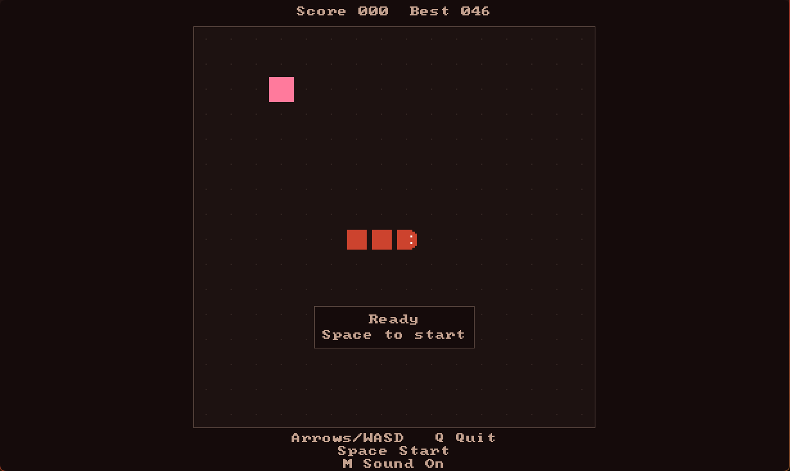

# Omarchy Snake

Snake for Omarchy. Fill the 16 × 16 board without running into yourself. The game follows your Omarchy theme as it changes and saves your high score locally.



## Install and play

**Omarchy or Arch Linux with Wayland (x86_64).** Run this command from any directory. No Rust toolchain or source checkout required.

```bash
( pkg=$(mktemp --suffix=.pkg.tar.zst) || exit; trap 'rm -f -- "$pkg"' EXIT; curl -fL -o "$pkg" https://github.com/offluisangel/snake/releases/download/v0.1.0/omarchy-snake-0.1.0-1-x86_64.pkg.tar.zst && printf '%s  %s\n' 963a7ccf35cac893be27c51fb046403989c434fe7afe09c62eabf455b0e315df "$pkg" | sha256sum -c - && sudo pacman -U "$pkg" )
```

The command downloads and verifies the [v0.1.0 package](https://github.com/offluisangel/snake/releases/tag/v0.1.0). Confirm the installation when `pacman` prompts you, then open **Omarchy Snake** from **Apps** or run `omarchy-snake`.

| Key | Action |
| --- | --- |
| Arrow keys or WASD | Turn |
| Space | Start, pause, resume, or play again |
| M | Toggle sound effects |
| Q | Quit |

To uninstall, run `sudo pacman -R omarchy-snake`.

## Run and test from source

With Rust and Cargo installed, run these commands from the repository root:

```bash
cargo run --locked --release  # Launch the game
cargo test --locked           # Run the tests
```
